# Trivia app evidence

These screenshots show the same Flutter source in `lib/main.dart`. Screenshots 01–09 come from a live round in Safari. Screenshots 10–11 come from a controlled Flutter widget test, as labeled below. They show real rendered app states, but they are not evidence of an Open Trivia Database outage.

## 1. Live questions and the answer-feedback loop

The app requested five easy, multiple-choice general-knowledge questions from the required endpoint. The successful screen is reached only after checking HTTP status `200`, API `response_code == 0`, and a five-question results list. The endpoint and checks are in `_loadTriviaData`; entity cleanup and answer shuffling are in `Question.fromJson`.

**01 — First live question.** The screen shows Question 1 of 5, a progress bar, and four answer choices. No Next button appears before answering.

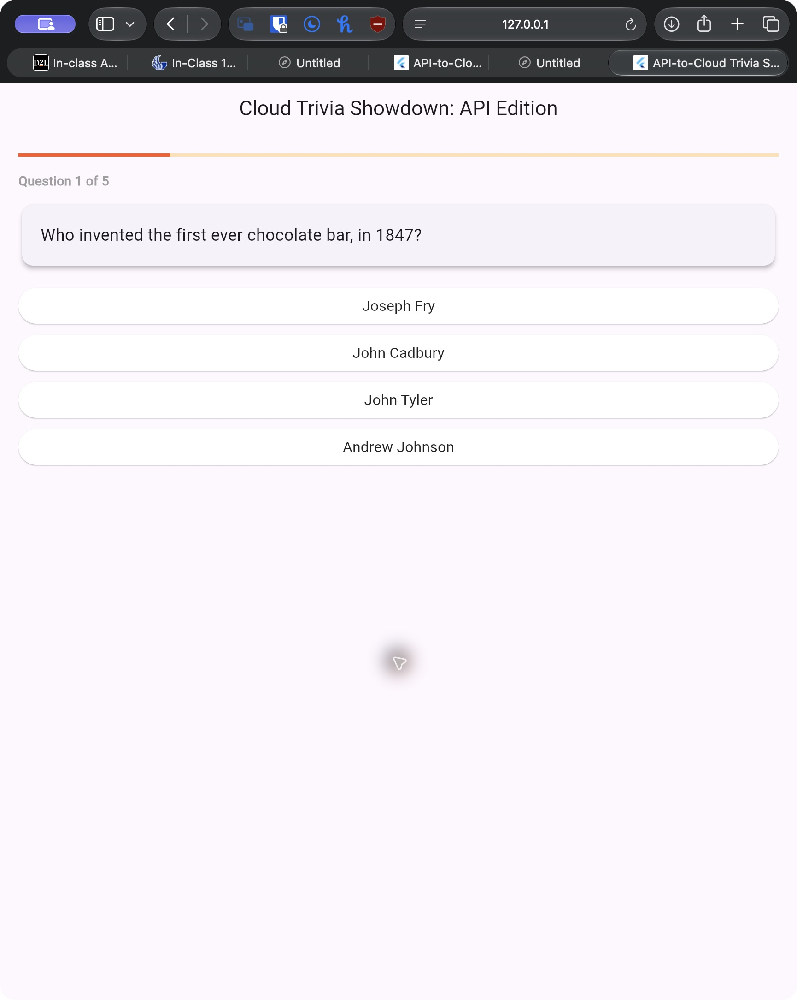

**02 — Incorrect answer and correct answer revealed.** Selecting John Cadbury turns that choice red and Joseph Fry green. A second tap on Joseph Fry left the original selection unchanged. That first question still counted as incorrect in the final 4/5 score.

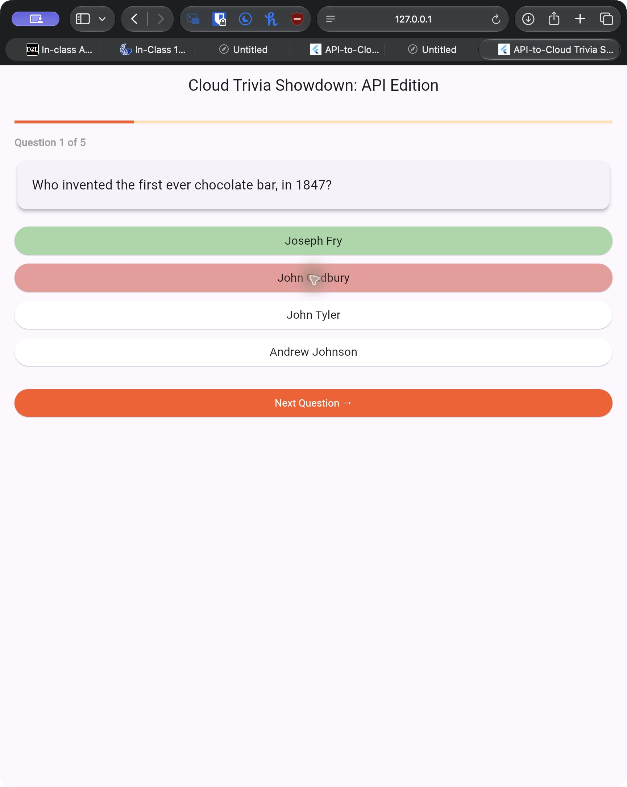

**03 — Correct answer and progression.** On Question 2 of 5, Cherries turns green. The next question is available after the answer is selected.

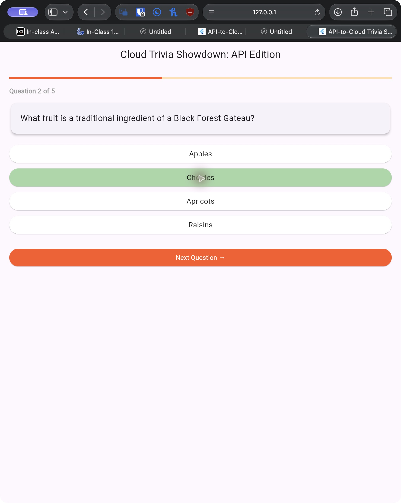

**04 — Third question.** The round advances to Question 3 of 5, with 19 selected.

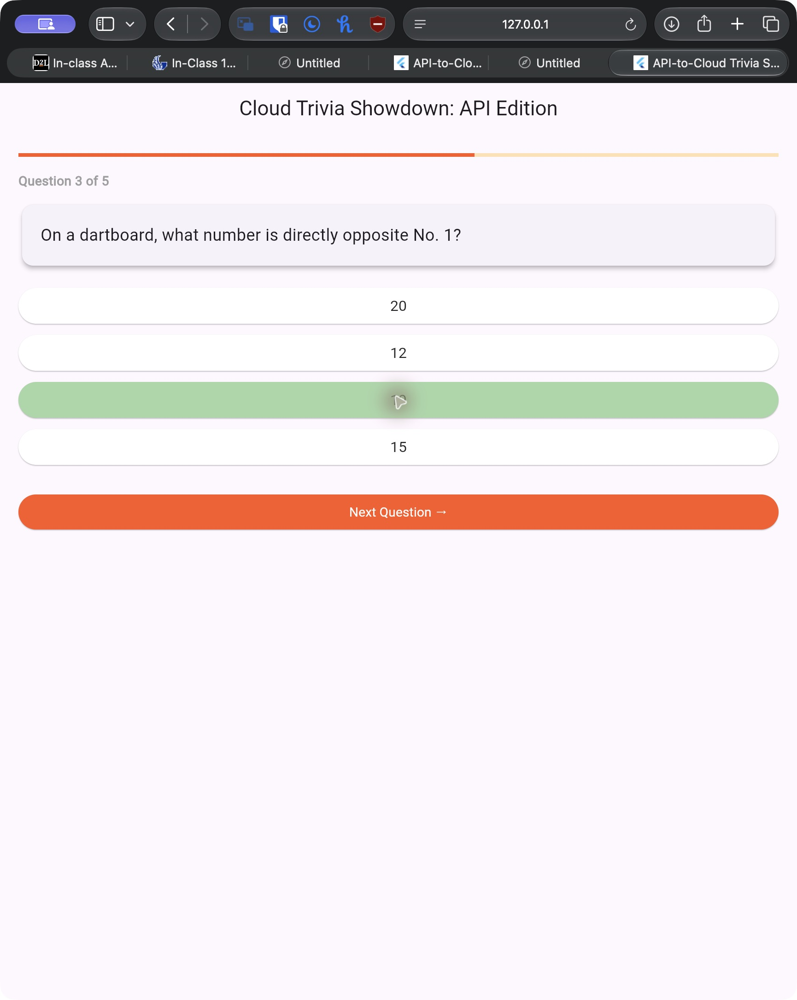

**05 — Fourth question.** The round advances to Question 4 of 5, with German selected.

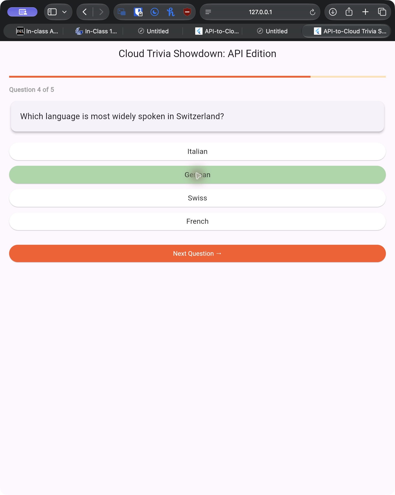

**06 — Fifth question.** The final question shows 100% progress, Vodka selected, and the View Final Score action.

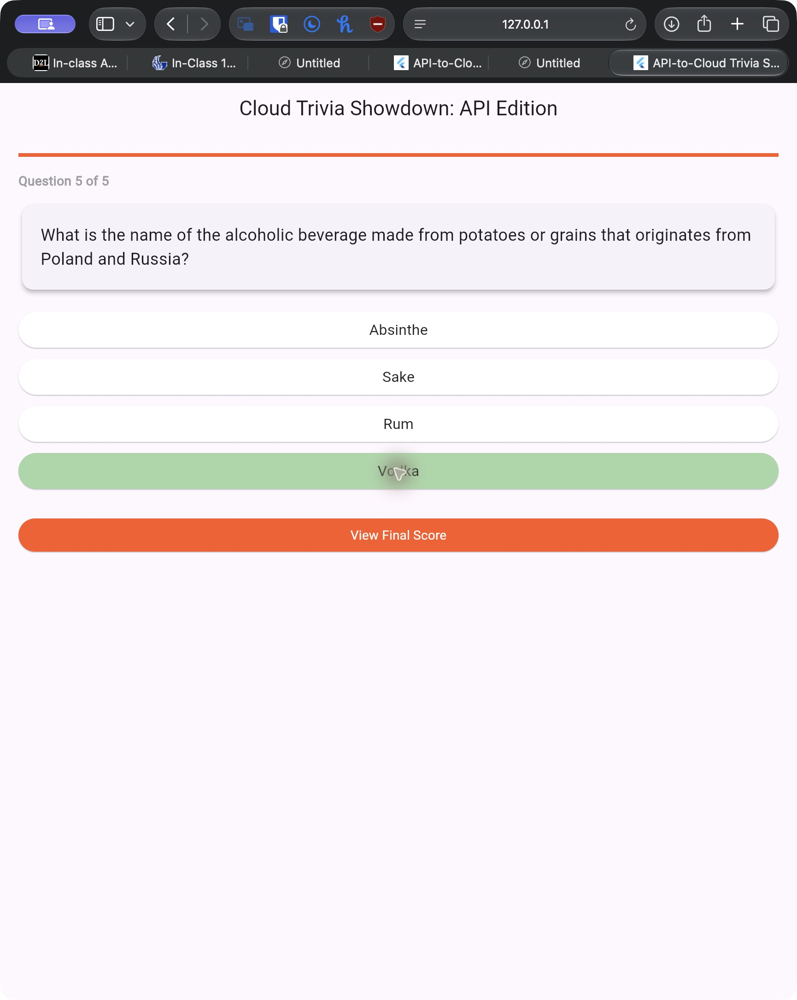

## 2. Round completion and score

**07 — Final score.** One incorrect answer followed by four correct answers produced **4 / 5**. The repeated tap on the first question did not add a point. The results screen offers both the simulated score action and Play Again.

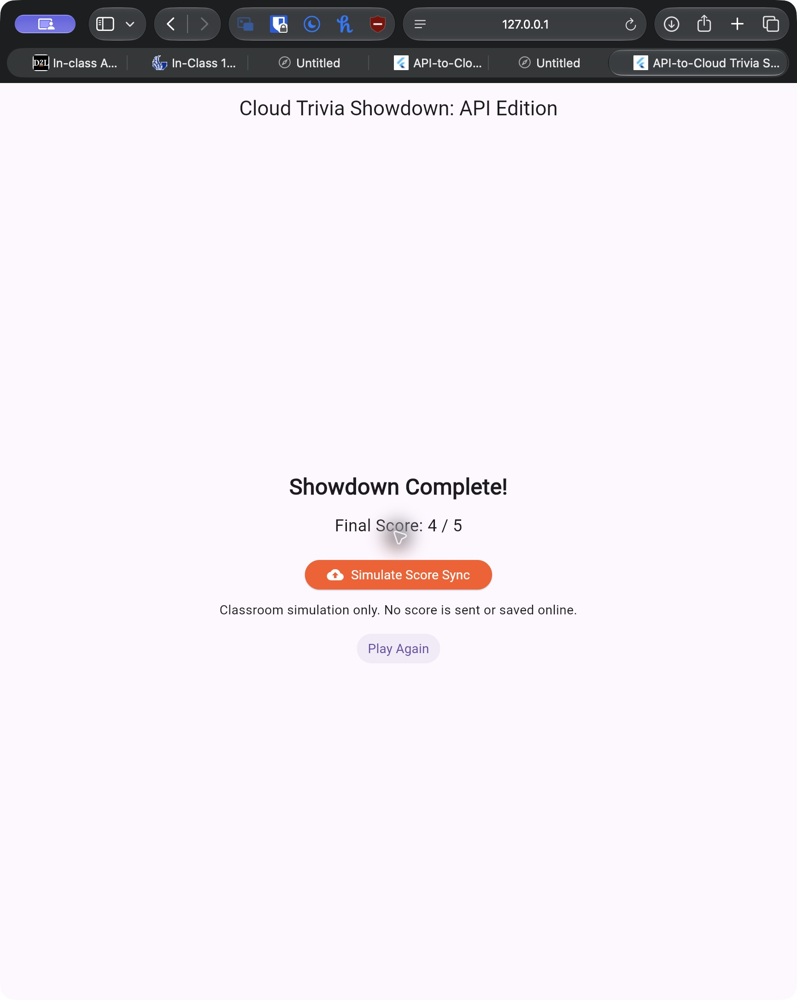

## 3. Score-sync proof

**08 — Simulation confirmation and payload.** The screen explicitly says **Sync Simulation Complete** and **No score is sent or saved online**. The displayed JSON contains the observed score and total. `_syncScoreToCloud` uses a one-second delay; it contains no backend request. The tests also check that this action causes no additional HTTP request.

```json
{"score":4,"totalQuestions":5,"submittedAt":"2026-11-12T01:39:22.653Z"}
```

The timestamp is UTC; the capture was on November 11 in Eastern Standard Time. This is a locally displayed simulation payload, not a server receipt or remote persistence claim.

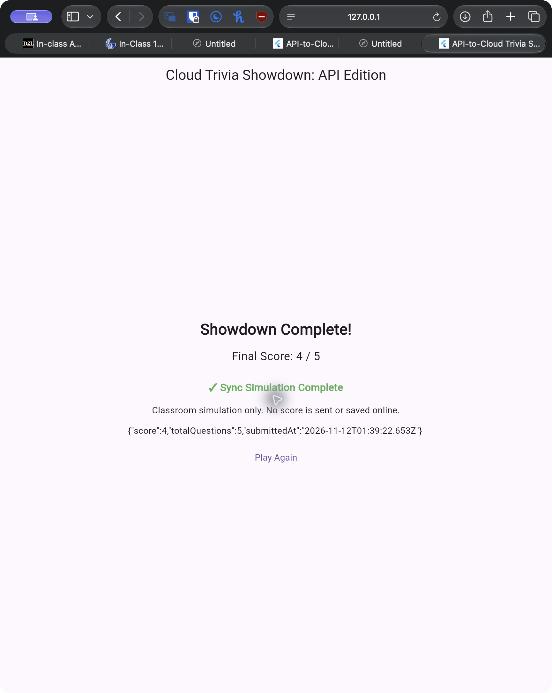

## 4. Replay

**09 — A new round.** Selecting Play Again returns to Question 1 of 5 with a different live question about a deck of cards and unselected answers. The previous score and sync state are reset. The deterministic replay test additionally finishes the next round to verify the reset score.

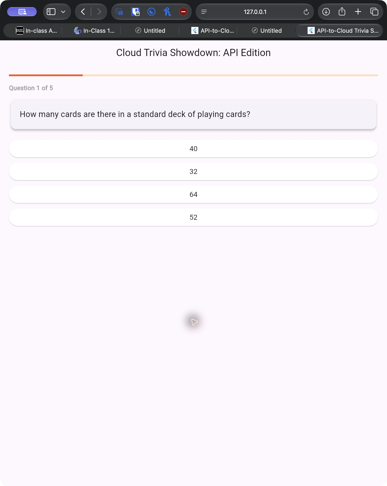

## 5. Loading and an observed error

**10 — Controlled loading state.** In `test/evidence_capture_test.dart`, a `MockClient` holds the HTTP response pending. The real app displays its progress indicator while waiting. This is a controlled test capture, not a separate mock interface.

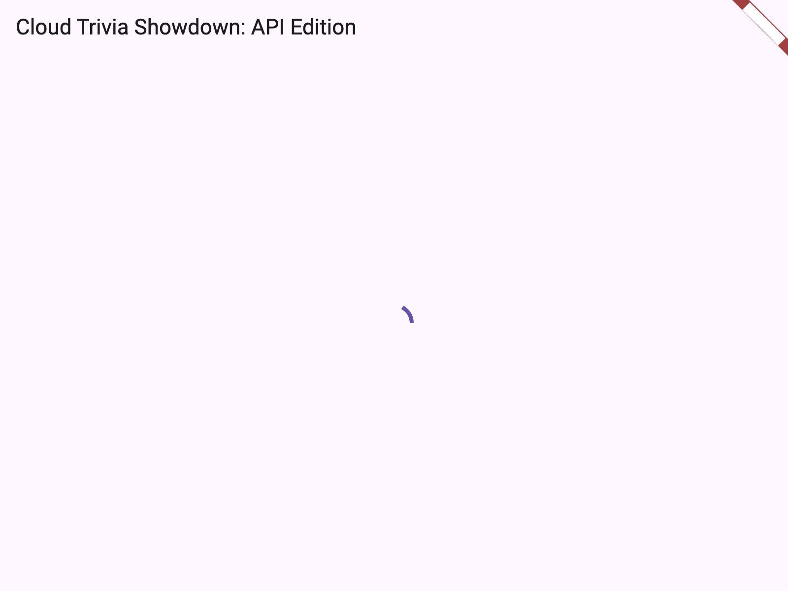

**11 — Controlled HTTP 503 response.** Completing that pending request with HTTP 503 displays **Server error: 503. Please try again.** and a Try Again button. The app does not display an empty successful round. The separate retry test verifies recovery from a 503 response to usable questions.

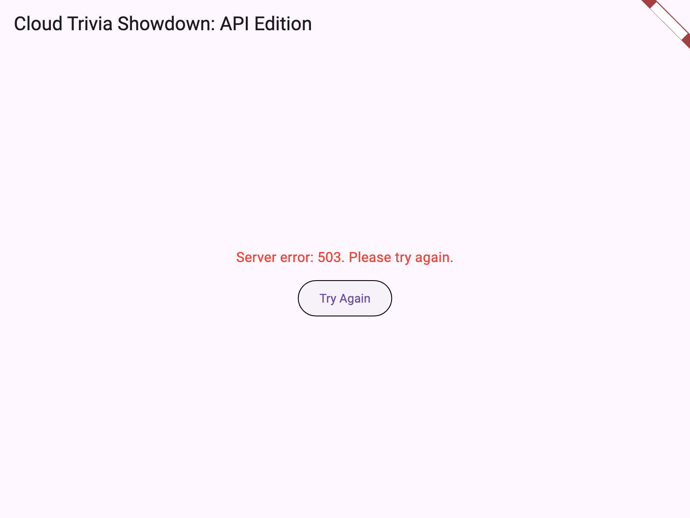

## Reproducing the checks

Run `flutter test --reporter expanded` from the project folder. Ten tests cover the quiz behavior and controlled captures. The capture test regenerates screenshots 10 and 11 using the included test font; its license is in `test/fonts/LICENSE.txt`.

For another live round in Safari, run `flutter run -d web-server` and open the printed local URL. The question text and answer order can change because the questions are fetched live and the choices are shuffled.
